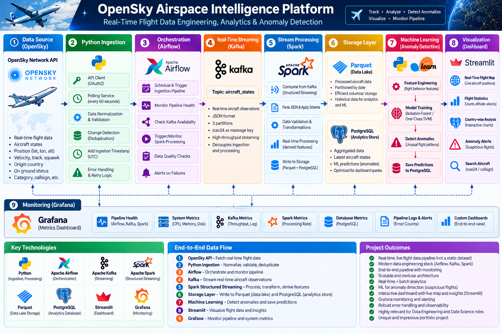

# ✈️ Airspace Intelligence & Flight Operations Analytics Platform


**An end-to-end data engineering platform for ingesting, streaming, processing, storing, analyzing, and visualizing aircraft state data from the OpenSky Network.** Built with Kafka, Spark Structured Streaming, PostgreSQL, Airflow, Streamlit, Grafana, and an optional machine-learning anomaly detection workflow.

> **Important:** ML anomaly flags are statistical signals, not confirmed flight-safety incidents. This repository is a learning/portfolio project, not a certified aviation monitoring system.

---

## 🧭 Architecture Diagram



*High-level view of the OpenSky ingestion pipeline, streaming and storage layers, orchestration, machine-learning workflow, dashboard, and monitoring components.*

---

## 🧠 What it demonstrates

- **API ingestion:** OAuth2 client-credentials flow for OpenSky, with configurable polling and normalized aircraft-state records.
- **Streaming:** Kafka topic `aircraft_states` decouples ingestion from downstream processing.
- **Stream processing:** Spark Structured Streaming validates/transforms incoming events and writes processed data to Parquet.
- **Analytical storage:** PostgreSQL stores historical aircraft observations using an idempotent key of `(icao24, observation_time)`.
- **Analytics and data quality:** SQL views and checks support activity trends, aircraft status, country-level summaries, plausibility checks, and snapshot-gap inspection.
- **Orchestration:** Airflow schedules the pipeline and maintenance/data-quality workflows. It orchestrates services; it is not a data-processing hop between Kafka and Spark.
- **Dashboard:** Streamlit provides pages for overview, live airspace, flight exploration, analytics, data quality, ML anomalies, and project guidance.
- **Monitoring:** An optional monitoring profile samples pipeline state into PostgreSQL and provisions a Grafana dashboard.
- **ML extension:** An optional Isolation Forest workflow trains versioned models and stores versioned anomaly predictions separately from source observations.
- **Reliability and performance:** The observation loader is designed to be idempotent; the Phase 12 update adds incremental file tracking and optional refresh workers.

## Architecture & Data Flow

```text
OpenSky Network API
        |
        v
Python ingestion, normalization and validation
        |
        v
Kafka: aircraft_states
        |
        v
Spark Structured Streaming
        |                         \
        v                          v
Parquet processed data       PostgreSQL observations
                                   |
                     +-------------+--------------+
                     |             |              |
                     v             v              v
                 Streamlit       SQL views      ML predictions
                     ^                            ^
                     |                            |
                  PostgreSQL                 Isolation Forest

Airflow: schedules/orchestrates pipeline and maintenance tasks
Grafana: visualizes optional pipeline-monitoring samples from PostgreSQL
```

Airflow and Grafana are orchestration/observability layers, not stages in the Kafka-to-Spark data path.

## Technology stack

| Area | Technology |
|---|---|
| Source | OpenSky Network REST API, OAuth2 |
| Ingestion and validation | Python |
| Event streaming | Apache Kafka |
| Stream processing | Apache Spark Structured Streaming |
| Processed files | Parquet |
| Warehouse / analytics store | PostgreSQL |
| Orchestration | Apache Airflow |
| Dashboard | Streamlit, Altair, PyDeck |
| Monitoring | Grafana and a lightweight PostgreSQL-backed monitor |
| Anomaly detection | scikit-learn Isolation Forest |
| Local environment | Docker Compose |

## Repository layout

```text
.
├── docker-compose.yaml          # Main local stack and optional profiles
├── compose.live.yaml            # Optional live refresh configuration
├── Dockerfile.*                 # Per-service container images
├── .env.example                 # Environment-variable template; no real secrets
├── architecture.png             # Architecture diagram
├── grafana/                     # Provisioned datasource and dashboard
├── src/
│   ├── main.py                  # Ingestion entry point
│   ├── opensky_client.py        # OpenSky API client
│   ├── normalizer.py            # Record normalization
│   ├── validator.py             # Data validation
│   ├── kafka_producer.py        # Kafka publishing
│   ├── kafka_consumer.py        # Consumer utility
│   ├── spark_streaming.py       # Spark Structured Streaming job
│   ├── postgres_loader.py       # Parquet-to-PostgreSQL loader
│   ├── incremental_loader.py    # Incremental loading support
│   ├── refresh_worker.py        # Optional refresh worker
│   ├── pipeline_monitor.py      # Monitoring sampler
│   ├── dags/                    # Airflow DAGs
│   ├── sql/                     # Analytics, quality, monitoring and ML SQL
│   └── ml/                      # Model training/scoring implementation
├── streamlit_app/               # Dashboard application and page views
├── requirements*.txt            # Service-specific Python dependencies
├── README_PHASE11.md            # ML design and operational details
├── README_PHASE12.md            # Dashboard/performance update notes
├── PHASE11_VALIDATION.md        # Scope and results of Phase 11 checks
├── PHASE12_VALIDATION.md        # Explicit Phase 12 test status
└── PERFORMANCE_GUIDE.md         # Optional performance update operations
```

## Prerequisites

- Windows 10/11 with Docker Desktop running, or another Docker Engine + Compose environment.
- Git (optional, for cloning/version control).
- An OpenSky Network account/application with OAuth2 client credentials.
- Enough free disk space for Docker images, Kafka data, Parquet files, PostgreSQL data, and Airflow/Grafana volumes.

All commands below are written for **PowerShell** and should be run from the project root (the directory containing `docker-compose.yaml`).

## 1. Configure environment variables

Create a local `.env` file from the template:

```powershell
Copy-Item .env.example .env
notepad .env
```

Set your own values for the OpenSky client ID/secret and PostgreSQL credentials. For Grafana, set strong values for `GRAFANA_PG_PASSWORD`, `GRAFANA_ADMIN_USER`, and `GRAFANA_ADMIN_PASSWORD` before enabling monitoring. Check `docker-compose.yaml` for any additional variables used by your local configuration.

**Never commit `.env` or paste its contents into issues, chats, screenshots, or public repositories.** Commit `.env.example` with placeholders only. If a real credential has been shared, rotate it.

## 2. Validate and start the core stack

First validate the Compose configuration without starting or recreating containers:

```powershell
docker compose config -q
```

If the command exits successfully, start the core services:

```powershell
docker compose up -d --build
```

Inspect service state and logs:

```powershell
docker compose ps
docker compose logs --tail 100
```

For a specific service:

```powershell
docker compose logs --tail 100 ingestion
docker compose logs --tail 100 kafka
docker compose logs --tail 100 spark
docker compose logs --tail 100 postgres
docker compose logs --tail 100 airflow
docker compose logs --tail 100 dashboard
```

The first build can take several minutes. Confirm that dependencies are healthy and review logs before assuming the end-to-end pipeline is operating normally.

## 3. Open the applications

| Service | Local URL | Notes |
|---|---|---|
| Streamlit dashboard | [http://localhost:8501](http://localhost:8501) | Main user-facing dashboard |
| Airflow | [http://localhost:8080](http://localhost:8080) | Workflow UI; use credentials configured for your environment |
| PostgreSQL | `localhost:5432` | Database endpoint for local SQL clients |
| Kafka | `localhost:9092` | Host-accessible Kafka listener |
| Grafana | [http://localhost:3000](http://localhost:3000) | Available when the `monitoring` profile is enabled |

Do not assume default passwords are secure or present. Use the credentials you configured in `.env` and the actual Airflow initialization behavior in `docker-compose.yaml`.

## 4. Enable Grafana monitoring (optional)

The monitoring services use the Compose profile `monitoring`. Configure the Grafana variables in `.env`, then validate the profile and start the monitoring components:

```powershell
docker compose --profile monitoring config -q
docker compose --profile monitoring up -d --build monitor grafana
```

Check initialization and service logs:

```powershell
docker compose ps -a grafana-init monitor grafana
docker compose logs --tail 100 grafana-init monitor grafana
```

Open [http://localhost:3000](http://localhost:3000) and sign in with the configured Grafana admin credentials. The provisioned dashboard is **Airspace Pipeline Monitoring**. See [`grafana/README.md`](grafana/README.md) for details.

## 5. Run the optional ML workflow

The ML service is an explicit one-shot Compose profile. It uses the project’s ML requirements and shared artifact directory. Read [`README_PHASE11.md`](README_PHASE11.md) and [`PHASE11_VALIDATION.md`](PHASE11_VALIDATION.md) before running training or scoring.

Validate the ML profile first:

```powershell
docker compose --profile ml config -q
```

The intended workflow is to initialize the ML tables, train a versioned model, and then score eligible observations using the CLI exposed by `src.ml`. Inspect the module help and the documented configuration before choosing the exact command:

```powershell
docker compose run --rm ml python -m src.ml --help
```

Do not train or activate a new model merely to make the dashboard look populated. Use the documented workflow, inspect the results, and keep the existing active model/artifacts until a replacement has completed successfully.

## 6. Dashboard pages

The Streamlit application is organized around these tasks:

- **Overview:** high-level pipeline and aircraft-observation KPIs.
- **Live Airspace:** recent aircraft positions on a map, with filters and display limits.
- **Flight Explorer:** inspect an aircraft and its available observation history.
- **Analytics:** historical activity and aggregated flight metrics.
- **Data Quality:** data checks, warnings, and snapshot-gap context.
- **ML Anomalies:** inspect model predictions and the observations behind them.
- **About / Pipeline Guide:** architecture, terminology, coverage, and interpretation notes.

The API provides periodic snapshots, not a guaranteed continuous radar track. Data coverage depends on the upstream API, polling, validation, processing, and storage. A missing point or time gap should not be interpreted as proof that an aircraft was absent.

## 7. Data model and reliability notes

- The main PostgreSQL table is `aircraft_observations` with 23 columns.
- Its idempotency key is `(icao24, observation_time)`. Reprocessing the same aircraft observation should not create a duplicate row.
- Analytics and data-quality SQL lives under `src/sql/`.
- ML model registry and anomaly predictions are stored separately from the source observation history.
- ML predictions are versioned by model; anomaly scores are not probabilities and are not a safety-risk rating.
- The monitoring profile samples pipeline state into PostgreSQL for Grafana to query.
- The Phase 12 incremental loader/refresh-worker changes are documented but **were not runtime-tested in the supplied validation report**. Treat them as needing local verification before relying on them for unattended operation.

## 8. Verification and testing

The project contains tests under `tests/` and phase-specific validation documents. Phase 11 reports passing source-level/unit checks in a Linux Python 3.12 sandbox, but it explicitly does not claim live PostgreSQL, real Airflow scheduler, Docker build, or full UI verification. Phase 12 validation explicitly marks compilation, tests, SQL integration, Compose checks, and runtime/benchmark checks as **not tested** for that revision.

Start with inexpensive, non-destructive checks:

```powershell
python -m compileall -q src streamlit_app tests
python -m unittest discover -s tests -v
docker compose config -q
```

Run Python checks in the environment with the project’s compatible dependencies installed. A passing compile or unit-test suite does not prove that the full multi-container pipeline is healthy; check the relevant container logs and dashboard pages as well.

## 9. Safe operating practices

- **Do not run `docker compose down -v`** unless you intentionally want to delete named volumes and understand the data loss. It can remove persistent Kafka, PostgreSQL, Airflow, and Grafana data.
- Avoid resetting Kafka topics/offsets or deleting Spark checkpoints as a routine troubleshooting step; doing so can change replay behavior or cause data loss/duplication.
- Do not modify historical observations to hide gaps or manufacture missing records.
- Test optional loader/worker changes against an isolated test database before enabling unattended use.
- Keep secrets out of Git and use read-only access for dashboards/monitoring wherever possible.
- Use `docker compose stop <service>` to stop a specific service without deleting volumes.

## 10. Troubleshooting checklist

1. Run `docker compose ps` and inspect the logs for the service that is unhealthy.
2. Validate environment variables and Compose syntax with `docker compose config -q`.
3. Confirm PostgreSQL is healthy before investigating dashboard queries or loader failures.
4. Confirm Kafka is reachable from the relevant containers and that the `aircraft_states` topic has messages before diagnosing Spark.
5. Check Spark logs and checkpoint status before changing streaming configuration.
6. Check Airflow DAG import errors in the Airflow UI/logs.
7. For Grafana, inspect `grafana-init`, `monitor`, and `grafana` logs, and confirm the configured read-only PostgreSQL role can query monitoring tables.
8. If the problem involves data volumes or offsets, take a backup and understand the consequences before making changes.

## Project documentation

- [`README_PHASE11.md`](README_PHASE11.md) — ML anomaly-detection design and operational contract.
- [`PHASE11_VALIDATION.md`](PHASE11_VALIDATION.md) — what was checked and what was not.
- [`README_PHASE12.md`](README_PHASE12.md) — dashboard redesign and performance changes.
- [`PHASE12_VALIDATION.md`](PHASE12_VALIDATION.md) — explicit validation status for Phase 12.
- [`PERFORMANCE_GUIDE.md`](PERFORMANCE_GUIDE.md) — operator instructions for incremental loading and optional workers.
- [`grafana/README.md`](grafana/README.md) — monitoring profile setup.
- [`OpenSky_Airspace_Intelligence_Full_Code_Walkthrough.pdf`](OpenSky_Airspace_Intelligence_Full_Code_Walkthrough.pdf) — code walkthrough.

## Future improvements (optional)

The core project already demonstrates a broad end-to-end data engineering stack. The highest-value next step is to verify the existing Phase 12 changes and capture a concise, honest demo—not to keep adding technologies. Once local verification is complete, add screenshots, a short demo video, and measured results that you actually observed.

---

**Built as a data engineering portfolio project** to demonstrate ingestion, event streaming, stream processing, analytical storage, orchestration, data quality, monitoring, dashboards, and an optional ML extension.
